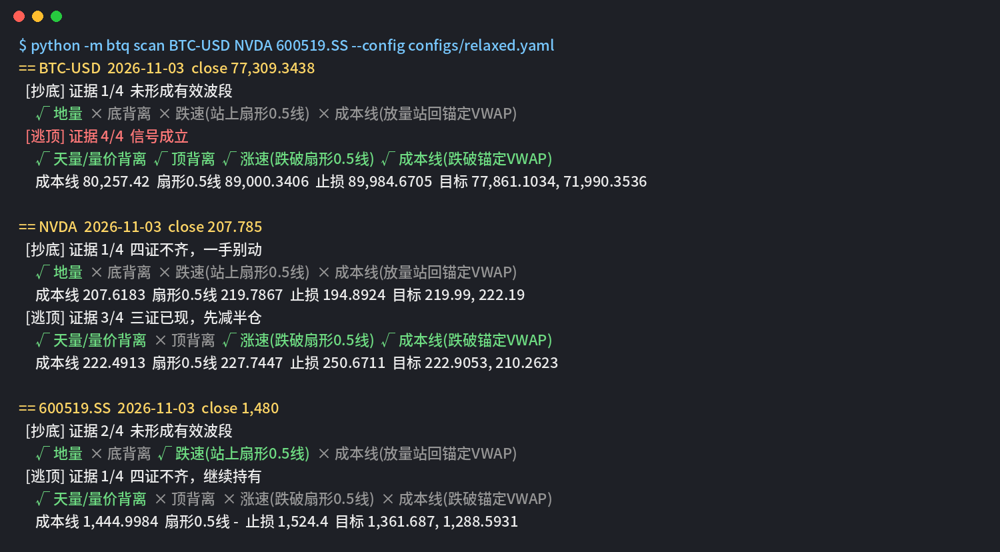
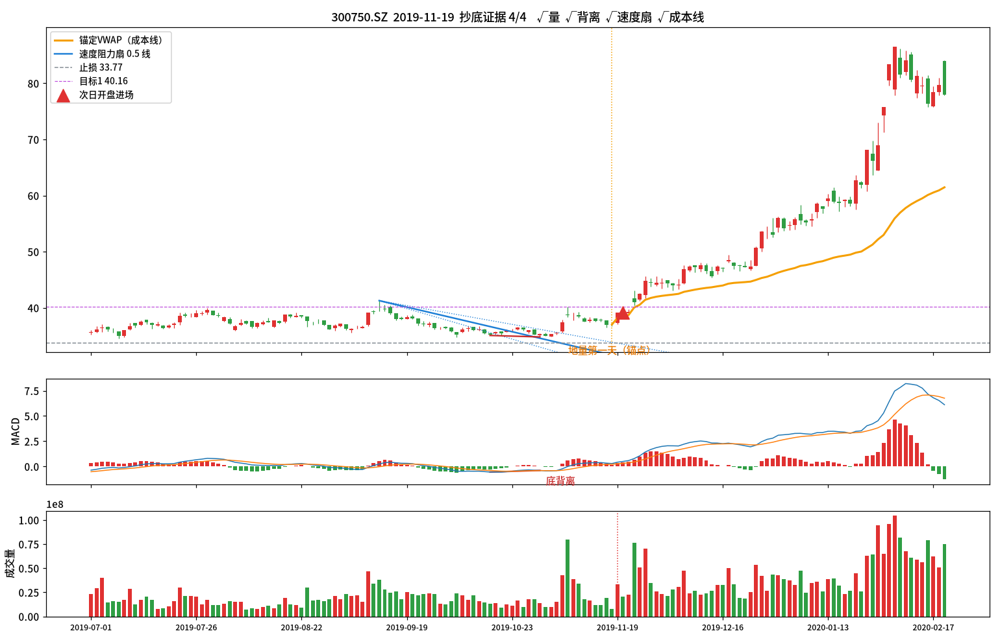
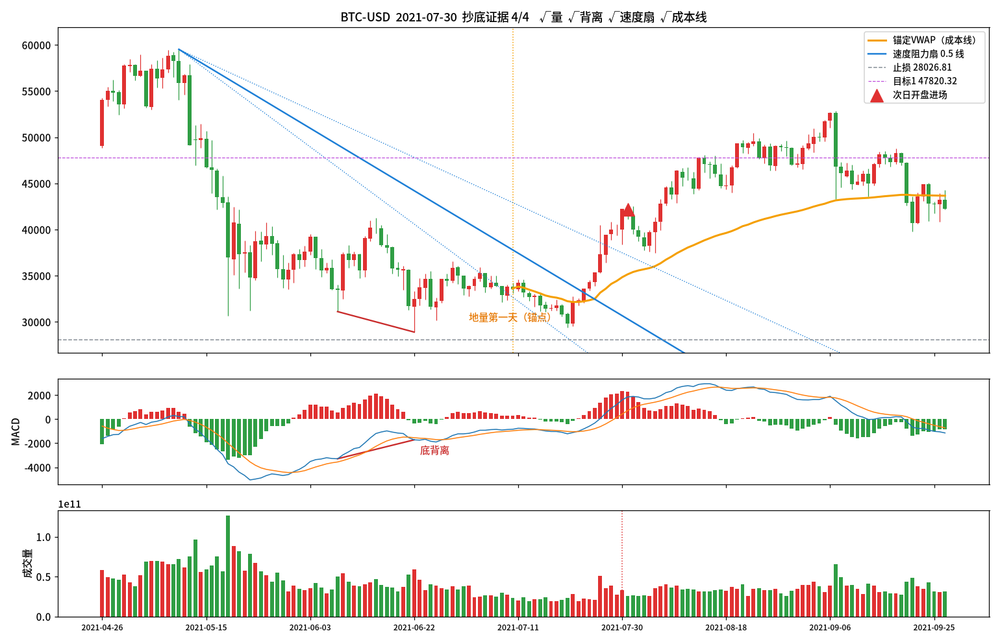
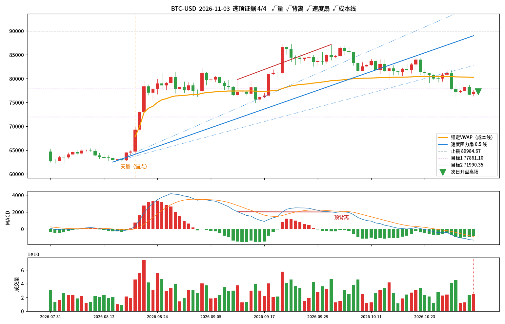
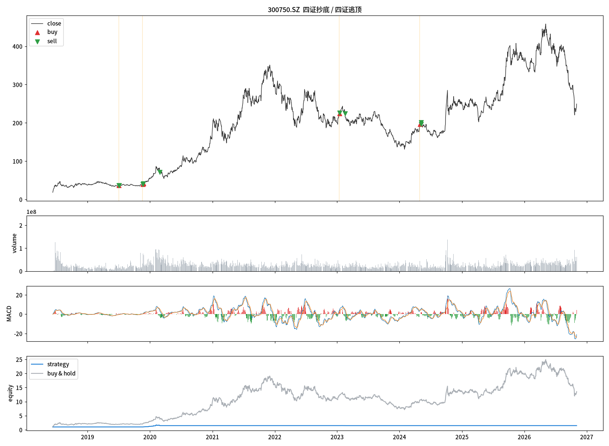

# btq · 四证抄底 / 四证逃顶 量化系统

把"底不是喊出来的"这套逻辑做成代码：**四条证据必须同时成立才动手**，四证不齐，一手别抄。
支持任意市场：A股、港股、美股、指数、加密货币、期货、外汇。数据源可以是 Yahoo、akshare、ccxt 或 CSV。

> 仅供研究和学习，不构成投资建议。历史回测不代表未来收益。

---

## 一、核心逻辑

### 抄底：四证齐全才进场

| # | 证据 | 规则（默认参数） | 代码 |
|---|------|------------------|------|
| 1 | **地量** | 下跌波段中，成交量缩到近 60 日最小。最近一段地量的第一天作为锚点。 | `signal.volume_window` |
| 2 | **底背离** | 价格创新低，MACD(12,26,9) 的 DIF 没有跟着创新低。用确认后的波段低点比较。 | `macd_*`, `pivot_k` |
| 3 | **跌速放缓** | 以波段高点为起点、波段最低点为终点画速度阻力扇（0.382 / 0.5 / 0.618）。收盘站上 **0.5 线**。 | `fan_ratio` |
| 4 | **成本线** | 从地量第一天开始累计**锚定 VWAP**（典型价 = (高+低+收)/3，AVWAP = Σ(典型价×量)/Σ量）。**放量站回**：收盘在 AVWAP 之上，并且成交量 ≥ 前 5 日均量的 **2.5 倍**。 | `reclaim_vol_mult` |

波段的定义：从最近一个有效高点算起，跌幅 ≥ 20%（`min_wave_move`），并且当前离波段最低点不超过 60 根 K 线。

### 仓位和风控

- **先上半仓**：四证齐全后，下一根 K 线开盘买入 50%。
- **加仓**：价格回踩成本线（AVWAP 上下 1.5% 以内）没有跌破，再加 50%。
- **止损**：波段最低点下方 3%。
- **判断错了**：收盘跌回成本线下方（超过 1%）就离场。可以用 `exit_on_avwap_break` 关掉。
- **目标**：第一目标是下跌途中最近的反弹高点（压力位）；没有的话用 0.382 回撤位。到第一目标卖掉一半，止损上移到成本价。剩下的仓位用 15% 移动止盈，或者等逃顶信号。

### 逃顶：抄底的镜像

| # | 证据 | 规则 |
|---|------|------|
| 1 | **天量 / 量价背离** | 上涨波段中出现近 60 日最大量（锚点），或者价格创新高但量比上一个高点小。 |
| 2 | **顶背离** | 价格创新高，DIF 没有创新高。 |
| 3 | **涨速衰竭** | 以波段低点为起点、高点为终点画速度扇，收盘跌破 0.5 线。 |
| 4 | **跌破成本线** | 收盘跌破从天量日开始累计的锚定 VWAP。默认不要求放量，可以用 `top.break_vol_mult` 打开。 |

- 逃顶 **3/4**：减仓一半。
- 逃顶 **4/4**：清仓。如果开了 `allow_short`（加密 / 期货），同时反手开空。

整个系统**不看未来数据**。信号在 K 线收盘时判断，下一根开盘成交。波段拐点要等确认后才会使用，有单元测试 `test_no_lookahead` 保证。

---

## 二、安装

```bash
git clone git@github.com:<你的用户名>/bottom-top-quant.git
cd bottom-top-quant
python -m venv .venv && source .venv/bin/activate    # Windows: .venv\Scripts\activate
pip install -r requirements.txt
# 可选：A股数据更准 pip install akshare；交易所加密货币 pip install ccxt
```

## 三、使用

### 1）扫描：现在离抄底 / 逃顶还差几条证据

```bash
python -m btq scan 600519.SS AAPL BTC-USD 0700.HK
```

实测输出（2026-11-03 收盘，宽松版参数）：



逃顶 3/4 时提示"三证已现，先减半仓"，4/4 时提示"信号成立"。

### 2）回测

```bash
python -m btq backtest 300750.SZ --start 2015-01-01 --config configs/relaxed.yaml --out reports
```

输出到 `reports/<标的>/`：`metrics.json`（收益、回撤、夏普、胜率、盈亏比，以及和买入持有的对比）、`trades.csv`（每笔交易）、`fills.csv`（每次成交和原因）、`signals.csv`、`equity.csv`、`chart.png`。

### 3）单个信号放大图：把四证画出来

```bash
export BTQ_FONT=/path/to/NotoSansSC-Regular.otf   # 可选：图里显示中文需要一个中文字体
python -m btq case 300750.SZ --date 2019-11-19 --config configs/relaxed.yaml --out case.png
python -m btq case BTC-USD --date 2026-11-03 --side top --out top.png
```

图里会画出：K 线、锚定 VWAP（成本线）、速度阻力扇（0.382 / 0.5 / 0.618）、地量或天量锚点、背离连线、止损和目标位，以及次日开盘的进场或离场点。

### 4）盯盘和推送

```bash
# 扫一次自选股，3/4 以上推送（适合 crontab）
python -m btq alert --watchlist watchlist.txt --webhook "https://qyapi.weixin.qq.com/cgi-bin/webhook/send?key=..."

# 常驻进程，每小时扫一次
python -m btq watch BTC-USD ETH-USD --every 3600 --webhook "..."
```

webhook 发送的 JSON 同时带 `msgtype/text`（企业微信、钉钉格式）和 `content`（通用格式），飞书、Discord 稍改一下 `btq/notify.py` 就能用。

### 5）用 GitHub Actions 每天自动扫描

仓库里自带 `.github/workflows/daily-scan.yml`。工作日北京时间 16:30（A股/港股收盘后）和 05:30（美股收盘后）各跑一次。
在仓库的 Settings → Secrets → Actions 里加上 `ALERT_WEBHOOK`，再改 `watchlist.txt`，就能每天收到推送。

## 四、标的写法（不限市场）

| 市场 | Yahoo 代码 | 其他数据源 |
|------|-----------|-----------|
| A股 | `600519.SS` `000001.SZ` `300750.SZ` | `akshare:600519` |
| A股指数 | `000001.SS`（Yahoo 的指数成交量有时不准，建议用 akshare） | `akshare:sh000001` |
| 港股 | `0700.HK` | |
| 美股 / ETF | `AAPL` `QQQ` | |
| 加密 | `BTC-USD` | `ccxt:binance:BTC/USDT` |
| 期货 / 外汇 | `GC=F` `CL=F` `USDCNY=X` | |
| 自有数据 | | `csv:path/to/file.csv`（列：date,open,high,low,close,volume） |

## 五、参数预设

- `configs/default.yaml`：**严格版**，完全按视频参数（地量 60 日、放量 2.5 倍、扇形 0.5 线、止损 3%）。信号很少，但质量最高。
- `configs/relaxed.yaml`：宽松版，放量倍数 1.8，波段幅度 15%。适合指数、大盘股、黄金这类成交量比较平滑的标的。
- `configs/crypto_long_short.yaml`：加密 / 期货用，4/4 逃顶后反手做空。

所有参数见 `btq/config.py`，在 YAML 里写哪个就覆盖哪个。

## 六、实测截图

### 抄底案例 1：宁德时代 300750.SZ，2019-11-19（宽松版）

地量第一天作为锚点，价格新低但 DIF 抬高（底背离），收盘站上速度扇 0.5 线，同时放量站回成本线，四证齐全。次日开盘先上半仓，之后沿着成本线一路上行。这一笔在回测里赚了 +47%。



### 抄底案例 2：BTC-USD，2021-07-30（宽松版）

从 6 万美元跌到 3 万附近：先出现底背离，然后地量，再放量站回成本线并突破扇形 0.5 线。



### 逃顶案例：BTC-USD，2026-11-03（严格版，今天的实时信号）

8 月出现天量，9 月底价格创新高但 DIF 没有跟上（顶背离），之后跌破扇形 0.5 线，又跌破从天量日开始算的成本线，逃顶 4/4。



### 完整回测：宁德时代 300750.SZ（宽松版）



## 七、回测参考（2015-01-01 至 2026-11-03，日线，佣金和滑点各 0.05%）

| 标的 | 严格版 收益 / 笔数 | 宽松版 收益 / 笔数 / 胜率 | 同期买入持有 |
|------|-----------------|--------------------------|------------|
| 300750.SZ 宁德时代（2018 年上市） | +0.6% / 1 | +47.8% / 4 / 75% | +1255% |
| BTC-USD | +15.0% / 2 | +13.9% / 5 / 80% | +24449% |
| AAPL | 0 笔 | +4.3% / 1 / 100% | +1300% |
| 0700.HK 腾讯 | 0 笔 | -1.0% / 3 / 33% | +306% |
| 600519.SS 茅台 | -2.7% / 1 | +0.7% / 2 / 50% | +916% |

结论：

1. 四证齐全的机会**很少**，十年里一个标的只有几次。这套规则擅长的是"别在半山腰抄底"，不是全天候策略。
2. 单笔胜率不错，最大回撤很小，但大部分时间空仓，所以总收益远远跑不赢长牛标的的买入持有。
3. 更合理的用法：把它当成**进场过滤器 / 提醒器**，用来盯一篮子标的；或者和你自己的长期仓位配合使用（底部加仓、顶部减仓）。

## 八、项目结构

```
btq/
  indicators.py   MACD、锚定 VWAP、速度阻力扇、确认后的拐点
  signals.py      四证抄底 / 四证逃顶判定（逐 K 线、无未来函数）
  backtest.py     事件驱动回测：半仓、加仓、止损、目标、移动止盈、逃顶减仓 / 清仓、可选做空
  report.py       图表和 CSV / JSON 报告
  data.py         Yahoo / akshare / ccxt / CSV 数据接口
  notify.py       Webhook 推送
  cli.py          scan / backtest / case / alert / watch 命令
docs/img/         README 里的实测截图
configs/          参数预设
tests/            单元测试（pytest）
```

运行测试：`pip install pytest && pytest -q`
